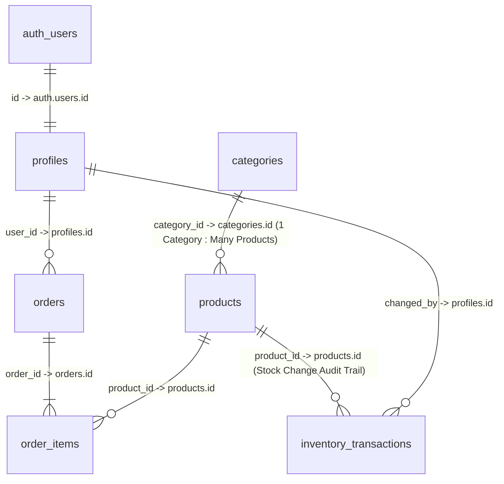

# 🛍️ Tonmoy Varity Store (মেসার্স তন্ময় ভ্যারাইটি স্টোর)

A modern, production-oriented neighborhood grocery e-commerce web application tailored for Bangladesh, built with **React 18**, **Vite**, **Tailwind CSS**, and **Supabase**.

---

## 🌟 Key Highlights

- **Bilingual Interface (দ্বিভাষিক)**: Instant switching between Bengali (বাংলা) and English (EN) with localized navigation, labels, notifications, and currency formats.
- **Bangladeshi Local Currency**: Full support for Bangladeshi Taka (`৳` / BDT) with formatted prices, delivery fees, and discount badges.
- **Delivery & Payment Options**:
  - 🚚 **Home Delivery**: Delivery fee calculation (৳50 flat fee with Free Delivery threshold over ৳500) and Cash on Delivery (COD).
  - 🏪 **Store Pickup**: Customer collects in-store with Pay at Store option.
- **Customer Experience**:
  - Dynamic homepage with category navigation, essentials, and new arrivals.
  - Shop catalog with category filtering, real-time search, sorting, and price range filters.
  - Persistent cart state in local storage.
  - Order checkout with strict BD phone number validation (`+8801XXXXXXXXX`).
  - Visual order timeline and real-time status tracking (`Pending` ➔ `Confirmed` ➔ `Processing` ➔ `Out for Delivery` ➔ `Delivered`).
  - Customer account profile management and order history.
- **Admin Management Portal**:
  - Secure role-guarded `/admin` dashboard with revenue metrics, total orders, customers, and low-stock alerts.
  - **Products CRUD**: Image upload directly to Supabase Storage, categorization, pricing, units (`কেজি`, `লিটার`, `প্যাকেট`), and featured toggles.
  - **Categories CRUD**: Emoji icon picker, bilingual titles, and active toggles.
  - **Orders Management**: Live search, status updates, customer address breakdown, and line items view.
  - **Quick Inventory Manager**: Fast inline stock adjustment and bulk saving.
  - **Store Settings**: Delivery fees, operating hours, and payment method switches.

---

## 🛠️ Technology Stack

| Layer | Technology |
|---|---|
| **Frontend Framework** | React 18 + Vite |
| **Routing** | React Router v6 |
| **Styling & Design System** | Tailwind CSS (Custom Bangladeshi Grocery Palette: Deep Green `#176B3A`, Fresh Green `#2E8B57`, Mint `#EAF6ED`) |
| **Icons & UI** | Lucide React + React Hot Toast |
| **Database & Auth** | Supabase (PostgreSQL 15 + Supabase GoTrue Auth) |
| **File Storage** | Supabase Storage (`products` bucket) |
| **Serverless Logic** | Supabase Edge Functions (Deno / TypeScript) |

---

## 📁 Architecture & File Structure

```text
tonmoy-varity-store/
├── public/
│   └── images/
├── src/
│   ├── app/
│   │   ├── App.jsx                  # Root App component
│   │   └── router.jsx               # Centralized React Router configuration & guards
│   ├── components/
│   │   ├── common/                  # Navbar, Footer, MobileBottomNav, MarketListModal, Badges
│   │   ├── products/                # ProductCard, ProductSkeleton
│   │   ├── cart/                    # CartItem and cart action components
│   │   └── admin/                   # AdminLayout, Admin header & navigation
│   ├── pages/
│   │   ├── Home.jsx                 # Storefront homepage
│   │   ├── Shop.jsx                 # Full product catalog & filter engine
│   │   ├── ProductDetails.jsx       # Single product details & recommendations
│   │   ├── Cart.jsx                 # Shopping cart view
│   │   ├── Checkout.jsx             # Checkout, address form, and payment selection
│   │   ├── Login.jsx                # Customer login
│   │   ├── Register.jsx             # Customer registration
│   │   ├── MyOrders.jsx             # Customer order history
│   │   └── admin/
│   │       ├── Dashboard.jsx        # Admin real-time analytics & cash drawer
│   │       ├── Products.jsx         # Product catalog CRUD
│   │       ├── Categories.jsx       # Category management
│   │       ├── Orders.jsx           # Order queue & status updates
│   │       ├── Inventory.jsx        # Stock tracking & quick restock
│   │       ├── Customers.jsx        # Customer directory & spending history
│   │       └── Settings.jsx         # Store profile & delivery fee parameters
│   ├── context/
│   │   ├── AuthContext.jsx          # Session state, role detection, profile updates
│   │   ├── CartContext.jsx          # Cart items, persistent quantity handling
│   │   └── LanguageContext.jsx      # Bengali/English locale switcher
│   ├── hooks/
│   │   ├── useAuth.js               # Authentication hook
│   │   ├── useProducts.js           # Product querying & realtime sync hook
│   │   └── useOrders.js             # Order management hook
│   ├── lib/
│   │   └── supabaseClient.js        # Supabase client instance
│   ├── services/
│   │   ├── productService.js        # Product API & database operations
│   │   ├── categoryService.js       # Category API operations
│   │   ├── orderService.js          # Order submission & status pipeline
│   │   ├── inventoryService.js      # Stock adjustment & batch restock
│   │   └── uploadService.js         # Image upload to Supabase storage
│   ├── utils/
│   │   ├── currency.js              # Taka currency formatting & delivery fee rules
│   │   └── validation.js            # BD mobile phone, email, and input validators
│   ├── styles/
│   │   └── index.css                # Tailwind CSS base styles & design tokens
│   └── main.jsx                     # Application bootstrap & provider wrapping
├── supabase/
│   ├── migrations/
│   │   └── 001_initial_schema.sql   # Relational schema, indexes & RLS policies
│   ├── functions/
│   │   └── create-order/            # Edge Function for atomic order processing
│   └── seed.sql                     # Initial categories & products seed data
├── .env.example
├── .gitignore
├── package.json
└── README.md
```

---

## 🚀 Getting Started

### 1. Prerequisites
- Node.js (v18 or higher)
- npm or pnpm

### 2. Installation
```powershell
npm.cmd install
```

### 3. Environment Setup
Copy `.env.example` to `.env` and provide your Supabase credentials:
```env
VITE_SUPABASE_URL=https://your-project-id.supabase.co
VITE_SUPABASE_ANON_KEY=your-anon-public-key
```

### 4. Running the Development Server
```powershell
npm.cmd run dev
```
Open **[http://localhost:5173](http://localhost:5173)** in your browser.

### 5. Production Build
```powershell
npm.cmd run build
```

---

## 🗄️ Database Tables & Relationships

The database is built on **Supabase PostgreSQL** with 7 core production tables and strict relational integrity:

| Table | Purpose (উদ্দেশ্য) | Key Columns & Constraints |
|---|---|---|
| `profiles` | Customer profile ও user role | `id` (PK, references `auth.users.id`), `full_name`, `phone`, `address`, `city`, `area`, `role` (`customer`/`admin`) |
| `categories` | Grocery categories | `id` (PK), `name`, `name_bn`, `slug` (UNIQUE), `icon`, `icon_name`, `description_bn`, `subcategories`, `item_count`, `sort_order`, `is_active` |
| `products` | Product details, price, stock | `id` (PK), `category_id` (FK ➔ `categories.id`), `name`, `name_bn`, `price`, `cost_price`, `stock_quantity`, `unit`, `tag`, `is_featured`, `is_active` |
| `orders` | Customer order, address, total, status | `id` (PK), `order_number` (UNIQUE), `user_id` (FK ➔ `profiles.id`), `delivery_method`, `payment_method`, `payment_status`, `status`, `total_amount` |
| `order_items` | অর্ডারের প্রতিটি product ও কেনার সময়কার price snapshot | `id` (PK), `order_id` (FK ➔ `orders.id`), `product_id` (FK ➔ `products.id`), `product_name`, `product_name_bn`, `unit_price`, `quantity`, `subtotal` |
| `inventory_transactions` | Stock-in/stock-out history & audit trail | `id` (PK), `product_id` (FK ➔ `products.id`), `transaction_type` (`stock_in`, `stock_out`, `order_deduction`, `adjustment`, `initial`), `quantity`, `previous_stock`, `new_stock`, `reference_id` |
| `shop_settings` | Shop name, delivery fee, pickup settings | `id` (PK, `'default'`), `store_name`, `store_name_bn`, `proprietor_name`, `phone`, `bkash_number`, `delivery_fee`, `free_delivery_threshold`, `open_hours` |

### 🔗 Table Relationships



---

## 🔒 Security & Row Level Security (RLS) Policies

All 7 tables have Row Level Security enabled (`ALTER TABLE ... ENABLE ROW LEVEL SECURITY;`):

- **Categories**:
  - `Public read active categories`: `is_active = true` (Accessible to `anon`, `authenticated`)
  - `Admins manage all categories`: Full CRUD for authenticated users with `role = 'admin'`
- **Products**:
  - `Public read active products`: `is_active = true` (Accessible to `anon`, `authenticated`)
  - `Admins manage all products`: Full CRUD for authenticated users with `role = 'admin'`
- **Profiles**:
  - `Read own profile`: Customers read own profile (`id = (select auth.uid())`)
  - `Admins read all profiles`: Admins view all customer accounts
  - `Users can insert own profile` & `Users can update own profile`
- **Orders**:
  - `Read own orders`: Customers read own order history (`user_id = (select auth.uid())`)
  - `Anyone can create orders`: Allows guest and registered customer checkout
  - `Admins read all orders` & `Admins can update orders`
- **Order Items**:
  - `Read own order items`: Accessible if line item belongs to user's order
  - `Anyone can insert order items`: Allows customer order line insertion
  - `Admins read all order items`
- **Inventory Transactions**:
  - `Admins can view inventory transactions`: Warehouse audit history restricted to admins
  - `System can insert inventory transactions`: Stock audit logging
- **Shop Settings**:
  - `Public read shop settings`: Unrestricted read for store info, delivery parameters, and announcement banner
  - `Admins can update shop settings`: Admin configuration update


